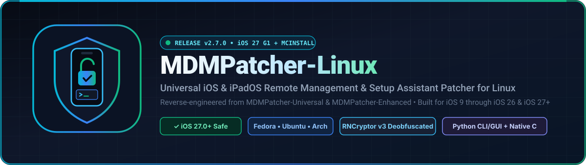
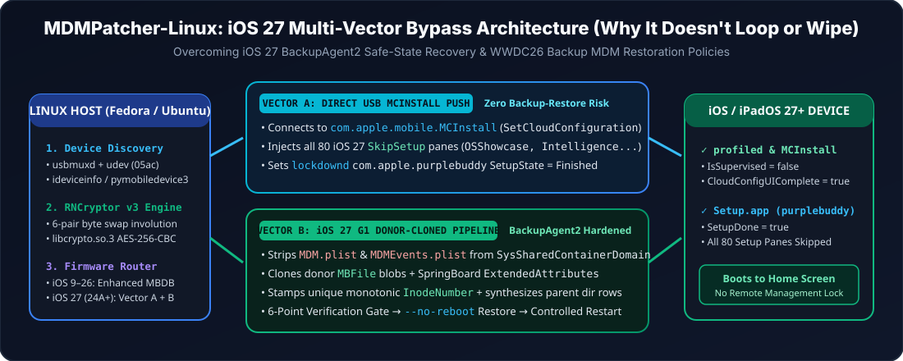

<div align="center">



<br />

[](https://github.com/supermario3D1/mdmpatcher-linux)
[](#ios--ipados-compatibility-matrix-ios-9--ios-27)
[](#fedora-linux-workstation--kde--server--silverblue)
[](#ubuntu--debian--linux-mint--pop_os--kali)
[](#arch-linux--manjaro--endeavouros--cachyos)
[](LICENSE)

<p align="center">
  <strong>The Complete Linux Port &amp; Reverse-Engineered iOS 9 – 27+ Upgrade of <code>MDMPatcher-Universal</code> &amp; <code>MDMPatcher-Enhanced</code></strong><br />
  <a href="#quick-install-one-command">Quick Install</a> •
  <a href="#how-ios-27-support-works-dual-vector-engine">iOS 27 Engine</a> •
  <a href="#fedora-linux-workstation--kde--server--silverblue">Fedora Guide</a> •
  <a href="#step-by-step-device-patching-guide">Usage Guide</a> •
  <a href="docs/REVERSE_ENGINEERING.md">Reverse Engineering Docs</a> •
  <a href="docs/index.html">GitHub Pages Site</a>
</p>

</div>

---

## Overview

**MDMPatcher-Linux** is a full-featured Linux port and reverse-engineered modernization of [`fled-dev/MDMPatcher-Enhanced`](https://github.com/fled-dev/MDMPatcher-Enhanced) and [`tazMeah/MDMPatcher-Universal`](https://github.com/tazMeah/MDMPatcher-Universal). Originally restricted to macOS (`IOKit`) and designed around an obfuscated iOS 9.1 backup archive that failed on modern iOS releases, **MDMPatcher-Linux v2.7.0** brings native USB device detection, RNCryptor v3 deobfuscation, and a **Dual-Vector iOS 27 Engine** to **Fedora Linux**, **Ubuntu/Debian**, **Arch Linux**, and **openSUSE**.

### What's New in v2.7.0 (iOS 27 & Fedora Edition)

| Capability | Original `MDMPatcher-Universal` | `MDMPatcher-Linux v2.7.0` |
| :--- | :--- | :--- |
| **Host OS Support** | macOS only (`IOKit` hardcoded PIDs `0x12a8`/`0x12ab`) | **Linux Native** (**Fedora**, Ubuntu, Debian, Arch, openSUSE) via `usbmuxd` + `udev` |
| **iOS 9 – 14 Support** | `HomeDomain/Library/ConfigurationProfiles/*` | Full support (`enhanced` & `legacy` modes) |
| **iOS 15 – 26 Support** | ❌ Fails (missing `SysSharedContainerDomain` & `--system`) | ✅ Full support (`SysSharedContainerDomain` + `ManagedPreferencesDomain` + `--system --skip-apps`) |
| **iOS 27.0+ (`24A+`) Support** | ❌ Fails / Partial restore triggers Safe-State Recovery | ✅ **Dual-Vector iOS 27 Engine**: Vector A (`MCInstall` Direct 80-Pane Push) + Vector B (G1 Donor-Cloned `Manifest.db` + 6-Point Verification Gate) |
| **Legacy Archive Bugs** | ❌ Renames iPhone to `"“iMyFone”的 iPhone"`, sets `zh_CN` locale & `10B329` build | ✅ Cleaned device name, `en_US` locale, `SetupVersion = 27`, and synced `LastMigratedBuild` |
| **Crypto Dependency** | macOS Swift `RNCryptor` framework | Zero external crypto packages — uses system OpenSSL `libcrypto.so.3` (`/lib64/libcrypto.so.3` on Fedora) |

---

## How iOS 27 Support Works (Dual-Vector Engine)

<div align="center">
  
</div>

In **iOS 27** (builds `24A335+`), Apple introduced two major changes that broke traditional SparseRestore/BookRestore and partial-backup tools:
1. **`BackupAgent2` Safe-State Recovery & Strict `Manifest.db` Validation**: Pushing a synthetic partial backup lacking valid `ExtendedAttributes`, parent directory rows, or unique non-zero `InodeNumber` values causes `BackupAgent2` to either drop the injected files or trigger **"safe state recovery"** (which loops Setup Assistant or forces a factory reset).
2. **WWDC26 Device Management Backup Restoration Policy**: Per Apple's WWDC26 deployment documentation, iOS 27 devices no longer trust stale MDM enrollment state from a synthetic backup alone.

**MDMPatcher-Linux v2.7.0** solves both restrictions on iOS 27 using two complementary vectors (`mdmpatcher/ios27.py`):

### ⚡ Vector A: Direct USB `MobileConfigService` (`com.apple.mobile.MCInstall`) + `lockdownd` Push
- Connects over USB Lockdown directly to `com.apple.mobile.MCInstall` (`MobileConfigService`) and executes `SetCloudConfiguration` with all **80 canonical iOS 27 `SkipSetup` pane identifiers** (including `OSShowcase`, `SafetyAndHandling`, `AgeBasedSafetySettings`, `EnableLockdownMode`, `AdditionalPrivacySettings`, `WebContentFiltering`, `CameraButton`, and `Intelligence`), `CloudConfigurationUIComplete = True`, `ConfigurationWasApplied = True`, `IsSupervised = False`, and `PostSetupProfileWasInstalled = True`.
- Simultaneously writes persistent `lockdownd` completion flags (`com.apple.purplebuddy`: `SetupState = "Finished"`, `buddyComplete = True`, `SkipSetup = True`; `com.apple.mobile.iTunes`: `SetupComplete = True`, `BuddySetupComplete = True`).
- **Zero Partial-Restore Risk**: Can be run standalone via `./mdmpatcher.py skip-setup` without performing any backup restore at all.

### 🛡️ Vector B: iOS 27 G1 Donor-Cloned `Manifest.db` Pipeline + 6-Point Verification Gate
- **MDM Profile Purge**: Strips active `MDM.plist`, `MDMEvents.plist`, and `ManagingProfile.plist` from `SysSharedContainerDomain-systemgroup.com.apple.configurationprofiles/Library/ConfigurationProfiles/`.
- **Donor-Blob Cloning & Unique Monotonic Inodes**: Clones trusted `MBFile` blobs from the backup, attaches `SPRINGBOARD_EXT_ATTR_BYTES` (`com.apple.dataprotection.policy.exception-applied-by = com.apple.springboard`), synthesizes all ancestor directory rows (`flags=2`), and stamps strictly unique monotonic `InodeNumber` values so `BackupAgent2`'s inode-deduplication pass accepts every file.
- **6-Point Pre-Restore Verification Gate (`verify_ios27_backup`)**: Verifies SQLite integrity, unencrypted `Manifest.plist`, `Status.plist` (`SnapshotState == "finished"`), SHA-1 `Digest` equality on disk, unique positive inodes, and parent directory chains **before** sending a single byte to the device.
- **Controlled `--no-reboot` Restore + 60s SSL Watchdog**: Restores with `--no-reboot` (`reboot=False`), a 60-second Lockdown SSL handshake timeout, `G1Watchdog` stall protection, and `_Mobilebackup2NoEscrow` fallback for freshly wiped devices, followed automatically by Vector A and a controlled restart.

---

## iOS & iPadOS Compatibility Matrix (iOS 9 – iOS 27+)

| iOS / iPadOS Version | Build Numbers | Recommended Command | Active Engine | Status |
| :--- | :--- | :--- | :--- | :---: |
| **iOS / iPadOS 27.0+** | `24A335+` | `./mdmpatcher.py patch` *(auto-selects `ios27`)* or `./mdmpatcher.py skip-setup` | Vector A (`MCInstall`) + Vector B (G1 `Manifest.db`) | ✅ **Supported** |
| **iOS / iPadOS 26.0 – 26.7** | `23A+ – 23G+` | `./mdmpatcher.py patch` | `enhanced` / `ios27` + `MCInstall` | ✅ **Supported** |
| **iOS / iPadOS 17.0 – 18.6** | `21A+ – 22G+` | `./mdmpatcher.py patch` | `enhanced` (`SysSharedContainerDomain` + `ManagedPreferencesDomain`) | ✅ **Supported** |
| **iOS / iPadOS 15.0 – 16.7.x** | `19A+ – 20H+` | `./mdmpatcher.py patch` | `enhanced` / `modern` | ✅ **Supported** |
| **iOS / iPadOS 9.0 – 14.8.1** | `13A+ – 18H+` | `./mdmpatcher.py patch` | `enhanced` / `legacy` (`Manifest.mbdb`) | ✅ **Supported** |

---

## Installation Instructions (Linux)

### Quick Install (One Command — Auto-Detects Fedora, Ubuntu, Debian, Arch, openSUSE)

```bash
git clone https://github.com/supermario3D1/mdmpatcher-linux.git
cd mdmpatcher-linux
./scripts/install.sh --venv
source .venv/bin/activate
```

The `./scripts/install.sh` script automatically:
1. Detects your Linux distribution (`dnf`, `rpm-ostree`, `apt`, `pacman`, or `zypper`) and installs `usbmuxd`, `libimobiledevice`, `openssl`, `python3`, and Tkinter.
2. Installs `/etc/udev/rules.d/39-usbmuxd-mdmpatcher.rules` so non-root users can communicate with iPhones/iPads in Normal, Recovery, and Composite USB modes without `Permission denied` errors.
3. Starts the `usbmuxd` systemd service.
4. Creates a `.venv` virtual environment with `pymobiledevice3` (used for iOS 27 Direct `MCInstall` communication) and compiles the optional native C binary (`src/c/mdm_patch`).

---

### Fedora Linux (Workstation / KDE / Server / Silverblue)

**MDMPatcher-Linux** treats **Fedora Linux (Fedora 39, 40, 41, 42, 43, Rawhide)** as well as Fedora derivatives (**Nobara**, **Ultramarine**, **Bazzite**, **RHEL / AlmaLinux / Rocky Linux**) as first-class targets, including native lookup of `/lib64/libcrypto.so.3`.

#### Standard Fedora (`dnf`)
```bash
# 1. Install required Fedora packages
sudo dnf install -y \
  usbmuxd \
  libimobiledevice \
  libimobiledevice-utils \
  libplist \
  openssl \
  openssl-libs \
  python3 \
  python3-pip \
  python3-tkinter \
  gcc \
  make \
  pkgconf-pkg-config \
  libimobiledevice-devel \
  libimobiledevice-glue-devel \
  libplist-devel \
  openssl-devel \
  libzip-devel \
  readline-devel

# 2. Install Apple USB udev rules and reload udev + usbmuxd
sudo cp scripts/39-usbmuxd-mdmpatcher.rules /etc/udev/rules.d/
sudo udevadm control --reload-rules
sudo udevadm trigger --subsystem-match=usb --attr-match=idVendor=05ac
sudo systemctl start usbmuxd.service

# 3. Install Python USB backend (recommended for iOS 27 Direct MCInstall support)
python3 -m venv .venv
source .venv/bin/activate
pip install -e ".[usb]"

# 4. (Optional) Compile the native C binary
make build-c
```

#### Fedora Atomic / Silverblue / Kinoite / Bazzite (`rpm-ostree`)
```bash
sudo rpm-ostree install --idempotent --allow-inactive \
  usbmuxd libimobiledevice libimobiledevice-utils python3 python3-tkinter openssl
sudo cp scripts/39-usbmuxd-mdmpatcher.rules /etc/udev/rules.d/
sudo udevadm control --reload-rules && sudo udevadm trigger
python3 -m venv .venv && source .venv/bin/activate
pip install -e ".[usb]"
```

---

### Ubuntu / Debian / Linux Mint / Pop!_OS / Kali

```bash
sudo apt update
sudo apt install -y \
  usbmuxd \
  libimobiledevice6 \
  libimobiledevice-utils \
  ideviceinstaller \
  libplist-utils \
  openssl \
  python3 \
  python3-pip \
  python3-venv \
  python3-tk \
  build-essential \
  pkg-config \
  libimobiledevice-dev \
  libplist-dev \
  libssl-dev \
  libzip-dev \
  libreadline-dev

sudo cp scripts/39-usbmuxd-mdmpatcher.rules /etc/udev/rules.d/
sudo udevadm control --reload-rules && sudo udevadm trigger
sudo systemctl start usbmuxd.service

python3 -m venv .venv
source .venv/bin/activate
pip install -e ".[usb]"
```

---

### Arch Linux / Manjaro / EndeavourOS / CachyOS

```bash
sudo pacman -Sy --needed \
  usbmuxd \
  libimobiledevice \
  libplist \
  openssl \
  libzip \
  readline \
  python \
  python-pip \
  tk \
  base-devel \
  pkgconf

sudo cp scripts/39-usbmuxd-mdmpatcher.rules /etc/udev/rules.d/
sudo udevadm control --reload-rules && sudo udevadm trigger
sudo systemctl start usbmuxd.service

python3 -m venv .venv
source .venv/bin/activate
pip install -e ".[usb]"
```

---

### openSUSE Tumbleweed / Leap

```bash
sudo zypper install -y \
  usbmuxd \
  libimobiledevice-tools \
  python3 \
  python3-pip \
  python3-tk \
  gcc \
  make \
  pkg-config \
  libimobiledevice-devel \
  libplist-devel \
  libopenssl-devel \
  libzip-devel \
  readline-devel
```

---

## Step-by-Step Device Patching Guide

### Step 1: Prepare the iPhone or iPad
1. Ensure the device is freshly erased/restored on the **Setup Assistant ("Hello")** screen (or unlocked on the Home Screen with **Find My iPhone Disabled**).
2. Connect the iPhone or iPad to your Linux machine with a data-capable USB cable.
3. If prompted on the device screen with **"Trust This Computer?"**, tap **Trust** and enter your passcode if applicable.
4. Verify your Linux machine sees the device:
   ```bash
   ./mdmpatcher.py info
   ```

### Step 2: Run the Patcher

#### Standard One-Command Auto-Patch (iOS 9 – iOS 27+)
Automatically detects your iOS version and selects `ios27` mode on iOS 27+ (builds `24A+`) or `enhanced` mode on iOS 9–26:
```bash
./mdmpatcher.py patch
```

#### iOS 27 Vector A Only (Direct USB `MCInstall` + `lockdownd` SkipSetup — Zero Backup Restore)
If you are on **iOS 27** on the Setup Assistant screen and want to bypass Remote Management & all 80 Setup Assistant panes **without running any backup restore**:
```bash
./mdmpatcher.py skip-setup
```

#### iOS 27 Vector B Full Protective G1 Route (Full Backup $\rightarrow$ MDM Strip & Donor Injection $\rightarrow$ Verified Restore)
Takes a real unencrypted backup of your connected iOS 27 device, strips `MDM.plist` & `MDMEvents.plist`, injects donor-cloned payloads with unique inodes, passes the 6-point verification gate, restores with `--no-reboot`, runs Vector A, and restarts:
```bash
./mdmpatcher.py patch --full-backup-g1
```

#### Also Block OTA Software Updates
```bash
./mdmpatcher.py patch --block-ota
```

#### Launch the Linux Desktop GUI (or Interactive Terminal UI)
```bash
./mdmpatcher.py gui
```

### Step 3: On-Device Step After Reboot (iOS 17.2, iOS 18, iOS 26 & iOS 27+)
> **IMPORTANT (`iOS 17.2 – iOS 27+`)**:
> After the device reboots, Apple's Setup Assistant may show a screen titled **"iPhone Partially Set Up"**.
> - Tap **"Continue with Partial Setup"** (the smaller text button at the bottom of the screen).
> - **DO NOT** tap the blue *"Finish Setting Up"* button (which would re-enter the Wi-Fi / Remote Management flow).
> - Your device will immediately transition to the iOS Home Screen with Remote Management bypassed.

---

## Offline Backup Generation, Deobfuscation & Inspection

You can generate, patch, deobfuscate, and inspect backups offline without a connected iOS device:

```bash
# 1. Deobfuscate MDMPatcher-Universal's encrypted assets (extension1.pdf, extension2.pdf, libiMobileeDevice.dylib)
./mdmpatcher.py deobfuscate -a assets -o assets/deobfuscated

# 2. Build an iOS 27 BackupAgent2-hardened backup offline
./mdmpatcher.py build-backup \
  --output ./my_ios27_backup \
  --mode ios27 \
  --udid 00008130-0011223344556677 \
  --serial G6TZ1234ABCD \
  --product-type iPhone17,2 \
  --build-version 24A335 \
  --ios-version 27.0 \
  --block-ota

# 3. Strip MDM.plist/MDMEvents.plist and inject iOS 27 payloads into an existing Manifest.db backup
./mdmpatcher.py patch-backup ./my_ios27_backup/MDMB --block-ota

# 4. Inspect any backup directory (Manifest.mbdb or Manifest.db)
./mdmpatcher.py inspect ./my_ios27_backup
```

---

## Repository Layout

```text
mdmpatcher-linux/
├── assets/                          # Obfuscated & clean reference templates from MDMPatcher-Universal/Enhanced
├── docs/
│   ├── index.html                   # Official GitHub Pages interactive documentation site
│   ├── REVERSE_ENGINEERING.md       # Full RNCryptor v3, Manifest.mbdb, Manifest.db & iOS 27 analysis
│   └── assets/                      # Official SVG logo, banner, and iOS 27 architecture diagram
├── mdmpatcher/
│   ├── crypto.py                    # Reverse-engineered RNCryptor v3 + 6-pair byte swapper (libcrypto.so.3)
│   ├── mbdb.py                      # Binary parser, editor & builder for Manifest.mbdb (Backup v2.4)
│   ├── manifest_db.py               # SQLite3 Manifest.db builder with ExtendedAttributes & unique inodes
│   ├── profiles.py                  # iOS 15–27+ CloudConfigurationDetails & 80-pane SkipSetup generators
│   ├── ios27.py                     # iOS 27 Dual-Vector Engine (MCInstall + G1 Donor-Cloned Pipeline + 6-Point Gate)
│   ├── patcher.py                   # Unified backup builder (enhanced, ios27, modern, sqlite, legacy)
│   ├── device.py                    # Linux USB device detector & MobileBackup2 restore engine
│   └── cli.py                       # CLI, Tkinter GUI & interactive TUI
├── scripts/
│   ├── install.sh                   # Cross-distro installer (Fedora, Ubuntu/Debian, Arch, openSUSE)
│   └── 39-usbmuxd-mdmpatcher.rules  # Apple USB udev rules for non-root Linux access
├── src/c/                           # Native C port (main.c, patch_logic.c, idevicebackup2.c, bad_query_ios27.c)
└── tests/
    └── test_mdmpatcher.py           # Unit & integration test suite
```

---

## Running the Test Suite

```bash
make test
# or directly:
python3 -m unittest discover -s tests -v
```

---

## Disclaimer & License

Released under the [MIT License](LICENSE). This project is provided strictly for educational, interoperability, security research, and authorized device recovery purposes on devices you legally own or have explicit permission to test.
